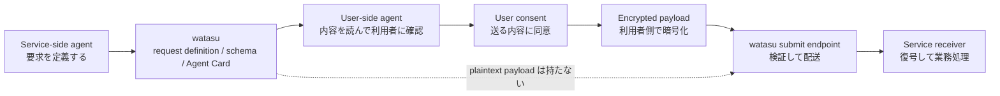

# watasu

[English README](README.md)

watasu は、サービス側が「個人データをどう受け取るか」を機械可読な contract として公開し、外部の利用ユーザー側 agent から encrypted submission を受け取るための agent-native intake rail です。

フォーム画面を作る代わりに、request definition、JSON Schema、Agent Card、A2A-compatible submit endpoint を公開します。watasu は payload を復号せず、plaintext payload を保存せず、配送結果だけを metadata-only に扱います。

## はじめて使う人へ

予備知識なしで触るなら、まず [docs/user-guide.ja.md](docs/user-guide.ja.md) を読んでください。図つきで、以下を順番に確認できます。

- watasu が何を担当し、何を担当しないか
- local demo で encrypted handoff を見る方法
- CLI で request definition、schema、Agent Card、ledger を確認する方法
- production private-alpha endpoint の生存確認
- payload を watasu に預けないことの確認ポイント

README は入口です。実際の利用手順は [利用者向けガイド](docs/user-guide.ja.md)、深い product / engineering contract は [PRD](docs/prd-cli-mvp.md)、[ERD](docs/erd-cli-mvp.md)、[MVP plan](docs/mvp-plan.md) に分けています。

## いま使える状態

2026-06-16 JST 時点の current status:

| Surface | Status | 使い方 |
| --- | --- | --- |
| Local Protocol MVP | Ready | `pnpm demo:handoff` |
| CLI | Ready | `pnpm --filter @watasu/cli watasu validate ...` |
| Local HTTP demo | Ready | `pnpm --filter @watasu/http demo` |
| Hosted API | Private-alpha ready | `https://api.watasu.ai/health` |
| Hosted MCP | Auth required | `https://api.watasu.ai/mcp` は Bearer token なしで 401 |
| Human dashboard UI | Not in scope | MVP では作らない |
| User-side personal vault / agent | Not in scope | 別プロダクトまたは adapter が担当 |

Latest verified evidence:

- `pnpm loop` passed: typecheck, tests, secret scan, self-review preflight
- test suite passed: 37 test files, 457 tests
- `pnpm demo:handoff` returned `ok: true`
- handoff evidence showed `ledger_contains_payload_body: false`
- handoff evidence showed `response_contains_plaintext_payload: false`
- `pnpm --silent cutover:verify` returned `decision: "go"` for `https://api.watasu.ai`
- live `/health` returned `{"ok":true,"service":"watasu-hosted"}`
- hosted MCP returned unauthenticated `401` with `WWW-Authenticate`, as intended

## しくみ



watasu が担当するのは、secure handoff rail です。

- request definition を検証する
- Agent Card と schema を公開する
- A2A HTTP+JSON submission を検証する
- encrypted envelope を service receiver に配送する
- payload body を保持せず、metadata-only ledger に限定する

watasu が担当しないもの:

- 人間向け dashboard UI
- 汎用 form builder
- 利用ユーザー側の personal vault
- 利用ユーザー側 agent / consumer AI companion
- 法的同意、本人確認、代理権限、規制対応、DSAR の保証

## Quick Start

```bash
pnpm install
pnpm loop
pnpm demo:handoff
```

期待する `pnpm demo:handoff` の要点:

```json
{
  "ok": true,
  "sender": {
    "payload_values_sent_to_watasu": false
  },
  "watasu": {
    "submit_status": 202,
    "delivery_status": "delivered",
    "ledger_contains_payload_body": false,
    "response_contains_plaintext_payload": false
  }
}
```

receiver 側がCSVへ追記するデモ slice は次で実行できます。

```bash
pnpm demo:receiver-csv
```

受信済みのdemo行は `receiver-demo-output/collected-submissions.csv` に追記されます。
`receiver-demo-output/` は Git 追跡外です。

## CLI examples

サンプル request definition:

```bash
packages/fixtures/requests/event-attendee.yaml
```

よく使う確認コマンド:

```bash
pnpm --filter @watasu/cli watasu validate packages/fixtures/requests/event-attendee.yaml
pnpm --filter @watasu/cli watasu schema packages/fixtures/requests/event-attendee.yaml
pnpm --filter @watasu/cli watasu publish packages/fixtures/requests/event-attendee.yaml --confirm
pnpm --filter @watasu/cli watasu agent-card packages/fixtures/requests/event-attendee.yaml --confirm
pnpm --filter @watasu/cli watasu ledger packages/fixtures/requests/event-attendee.yaml --confirm
pnpm --filter @watasu/cli watasu inspect-delivery packages/fixtures/requests/event-attendee.yaml --confirm
```

local JSON payload を sender fixture 経由で送る例:

```bash
printf '{"full_name":"Alice Example","email":"alice@example.test"}' > /tmp/watasu-payload.json
pnpm --filter @watasu/cli watasu submit-fixture packages/fixtures/requests/event-attendee.yaml --payload /tmp/watasu-payload.json --confirm
```

`submit-fixture` は学習用の local fixture です。production に payload を送る操作ではありません。

## Local HTTP demo

```bash
pnpm typecheck
pnpm --filter @watasu/http demo
```

Default local routes:

- `http://127.0.0.1:8787/.well-known/agent-card.json`
- `http://127.0.0.1:8787/schemas/plaintext.json`
- `http://127.0.0.1:8787/schemas/envelope.json`
- `POST http://127.0.0.1:8787/submit`
- `http://127.0.0.1:8787/ledger`

別 terminal で確認:

```bash
curl http://127.0.0.1:8787/.well-known/agent-card.json
curl http://127.0.0.1:8787/schemas/plaintext.json
curl http://127.0.0.1:8787/schemas/envelope.json
```

## Hosted private alpha

Production origin:

```text
https://api.watasu.ai
```

Public health check:

```bash
curl https://api.watasu.ai/health
```

Expected:

```json
{"ok":true,"service":"watasu-hosted"}
```

Hosted MCP metadata:

```bash
curl https://api.watasu.ai/.well-known/oauth-protected-resource
```

Hosted MCP transport:

```bash
curl https://api.watasu.ai/mcp
```

Bearer token なしでは `401` が正しい挙動です。

Hosted publish / ledger 操作は private-alpha の authenticated MCP / service identity 境界の内側で使います。まだ一般公開の self-serve UI ではありません。

Hosted private-alpha runtime は、まだ durable multi-tenant production service ではありません。live web process は explicit dependencies が注入されない限り published request versions と default replay / rate-limit state を memory に保持し、PostgreSQL は現時点では full web read/write custody ではなく retention dry-run evidence と durable request-version / capability / idempotency / rate-limit metadata primitives に使っています。DB-backed live runtime wiring と production capability administration はまだ production work です。実 private-alpha request の publish は design partner flow が決まってから行います。

## Verification loop

標準 loop:

```bash
pnpm loop
```

`pnpm loop` は `pnpm typecheck`、`pnpm exec vitest run`、`pnpm lint`、`pnpm review:self` を実行します。
`pnpm test` 単体は引き続き typecheck 込みですが、loop 内では重複する typecheck を省いて高速化しています。

依存、release gate、supply-chain 境界に触れた場合:

```bash
pnpm loop:full
```

Production cutover evidence:

```bash
pnpm --silent cutover:status
pnpm --silent cutover:verify
```

`cutover:verify` が `decision: "go"` を返したときだけ、private-alpha exposure の go 証跡として扱います。

Operator cutover commands:

```bash
pnpm --silent deploy:preflight
pnpm --silent render:brief
pnpm --silent cutover:plan
pnpm --silent cutover:prepare
pnpm --silent cutover:repo
pnpm --silent cutover:status
pnpm --silent cutover:ci
pnpm --silent cutover:canary
pnpm --silent cutover:retention
pnpm --silent cutover:verify
pnpm --silent smoke:hosted
pnpm --silent secret:identity --plain
```

cutover evidence は gitignored の `cutover-evidence/` に保存します。主な evidence files:

- `cutover-evidence/cutover-head.txt`
- `cutover-evidence/preflight.json`
- `cutover-evidence/smoke.json`
- `cutover-evidence/ci.json`
- `cutover-evidence/canary.json`
- `cutover-evidence/retention.json`

`pnpm --silent secret:identity --plain` は Render に入力する 32 byte base64url secret value だけを出します。`WATASU_SERVICE_IDENTITY_SIGNING_SECRET` と `WATASU_MCP_BEARER_TOKEN` には別々の値を使い、実値は Render secret prompt にだけ入力します。git、README、log、PR text には残しません。

## Documentation map

- [docs-site/](docs-site/): Rspress public docs source. `pnpm docs:build` で `llms.txt` / `llms-full.txt` つきの static site を生成します。
- [docs/user-guide.ja.md](docs/user-guide.ja.md): 予備知識なしの利用者向けガイド
- [docs/mvp-plan.md](docs/mvp-plan.md): current status、manual checks、production cutover evidence
- [docs/prd-cli-mvp.md](docs/prd-cli-mvp.md): product requirements
- [docs/erd-cli-mvp.md](docs/erd-cli-mvp.md): engineering requirements
- [docs/protocol-baseline.md](docs/protocol-baseline.md): protocol / dependency baseline
- [docs/loop-engineering.md](docs/loop-engineering.md): Codex / gstack loop rules

Public docs site:

```bash
pnpm docs:build
pnpm docs:preview
```

推奨 hosting は Cloudflare Pages です。build command は `pnpm install --frozen-lockfile && pnpm docs:build`、output directory は `doc_build`、custom domain は `docs.watasu.ai` を使います。

## Security promise

watasu の境界は **no payload custody** です。

- plaintext payload を受け取らない
- payload を復号しない
- plaintext payload を保存しない
- payload value を log / README / PR text に残さない
- delivery attempt 後に encrypted payload body を保持しない
- retry queue に payload body を積まず、失敗時は sender に `resubmit_later` を返す
- optional persistent ledger は metadata-only に限定する

テストが通ることは安全性の証明ではありません。セキュリティ境界に触れた変更では、`pnpm loop` に加えて、必要に応じて manual checks、secret scan、dependency audit、gstack review を実行します。
