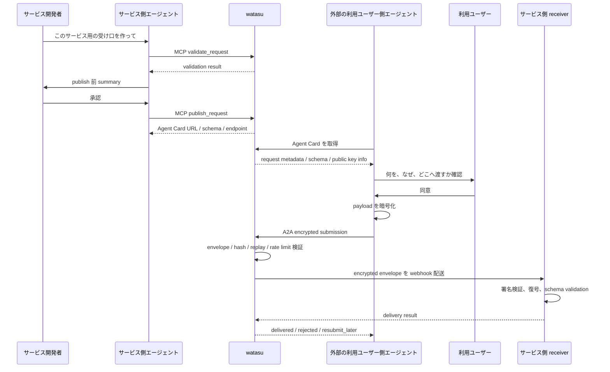

# watasu

[English README](README.md)

watasu は、サービス側エージェントが個人データの要求定義を作り、外部の利用ユーザー側エージェントが読める暗号化 intake endpoint を公開するための agent-native intake MVP です。

人間向けフォームを作る代わりに、「何を送るのか」「なぜ必要なのか」「どこへ届くのか」を request definition、schema、Agent Card として機械可読にします。ユーザー同意にもとづく encrypted submission を、watasu が復号せずにサービス側 webhook へ配送する土台を提供します。

## しくみの概要

詳しいプロダクト要件は [docs/prd-cli-mvp.md](docs/prd-cli-mvp.md)、実装契約は [docs/erd-cli-mvp.md](docs/erd-cli-mvp.md) にあります。README では、全体の流れだけを短くまとめます。



## セキュリティの約束

watasu の境界は **no payload custody** です。

- watasu は plaintext payload を受け取らず、復号せず、保存せず、log に出しません。
- watasu は service private key を持ちません。
- watasu は delivery attempt 後に encrypted payload body を保持しません。
- webhook delivery が失敗した場合、payload retry queue を持たず、sender に `resubmit_later` を返す設計です。
- 永続 ledger は default では使わず、有効化する場合も payload 値を含まない metadata-only ledger に限定します。

metadata も組み合わせると個人関連情報になり得ます。そのため optional persistent metadata には tenant、role、retention、audit の境界を適用します。watasu は法的同意、本人確認、代理権限、規制対応、DSAR を保証しません。それらはサービス側または別プロダクトの責務です。

## ワークスペース構成

```text
docs/
  prd-cli-mvp.md              プロダクト要件とスコープ
  erd-cli-mvp.md              実装要件、protocol、data model
  protocol-baseline.md        最新情報と依存確認の記録
  mvp-plan.md                 MVP段階、手動確認、実行フェーズ
  loop-engineering.md         Codex loop template と検証ルール
infra/
  postgres/                   Hosted PostgreSQL provisioning SQL artifacts
packages/
  core/                       request validation、hash、publish、schema、A2A、delivery
  cli/                        file-based watasu CLI wrapper
  fixtures/                   sample request definitions
  http/                       local HTTP demo server
  mcp/                        MCP server package
  hosted/                     production Node/PostgreSQL runtime package
scripts/                      loop、review、PR、secret-scan helpers
```

## Quick Start

```bash
pnpm install
pnpm typecheck
pnpm test
pnpm loop
pnpm demo:handoff
```

CLI examples:

```bash
pnpm --filter @watasu/cli watasu validate packages/fixtures/requests/event-attendee.yaml
pnpm --filter @watasu/cli watasu schema packages/fixtures/requests/event-attendee.yaml
pnpm --filter @watasu/cli watasu publish packages/fixtures/requests/event-attendee.yaml --confirm
pnpm --filter @watasu/cli watasu agent-card packages/fixtures/requests/event-attendee.yaml --confirm
pnpm --filter @watasu/cli watasu ledger packages/fixtures/requests/event-attendee.yaml --confirm
pnpm --filter @watasu/cli watasu inspect-delivery packages/fixtures/requests/event-attendee.yaml --confirm
```

payload 値を表示せずに local JSON payload を sender fixture 経由で送る例:

```bash
printf '{"full_name":"Alice Example","email":"alice@example.test"}' > /tmp/watasu-payload.json
pnpm --filter @watasu/cli watasu submit-fixture packages/fixtures/requests/event-attendee.yaml --payload /tmp/watasu-payload.json --confirm
```

## Local Demo

最初に build / typecheck してから local HTTP demo を起動します。

```bash
pnpm typecheck
pnpm --filter @watasu/http demo
```

Default server:

- `http://127.0.0.1:8787/.well-known/agent-card.json`
- `http://127.0.0.1:8787/schemas/plaintext.json`
- `http://127.0.0.1:8787/schemas/envelope.json`
- `POST http://127.0.0.1:8787/submit`
- `http://127.0.0.1:8787/ledger`

Manual checks:

```bash
curl http://127.0.0.1:8787/.well-known/agent-card.json
curl http://127.0.0.1:8787/schemas/plaintext.json
curl http://127.0.0.1:8787/schemas/envelope.json
```

`POST /submit` は A2A HTTP+JSON protocol gate、encrypted envelope validation、receiver fixture への配送、metadata-only ledger 記録を確認します。`Content-Type: application/a2a+json`、`A2A-Version: 1.0`、`A2A-Extensions: https://watasu.dev/extensions/encrypted-intake/v1` を使います。

server なしの end-to-end handoff check:

```bash
pnpm demo:handoff
```

handoff demo は local Agent Card、sender fixture、HTTP demo handler、receiver fixture、metadata-only ledger を 1 process でつなぎます。JSON output では `ok: true`、`ledger_contains_payload_body: false`、`response_contains_plaintext_payload: false` になるはずです。

## Verification Loop

標準ループ:

```bash
pnpm loop
```

`pnpm loop` は `pnpm typecheck`、`pnpm test`、`pnpm lint`、`pnpm review:self` を実行します。

依存、release gate、supply-chain 境界に触れた場合:

```bash
pnpm loop:full
```

Targeted checks:

```bash
pnpm typecheck
pnpm test
pnpm lint
pnpm review:self
pnpm exec vitest run packages/core/src/security-regression.test.ts
pnpm --filter @watasu/http test
```

`pnpm lint` は repository secret-scan helper を実行します。テストが通ることは安全性の証明ではありません。

## Current MVP Status

推奨される次の作業と手動確認は [docs/mvp-plan.md](docs/mvp-plan.md) を見てください。

Local Protocol MVP は実装済みで、手元で manual test できます。Repo-side Hosted Production MVP の library/runtime building blocks は存在し、`api.watasu.ai` 用に health-check 可能な最初の deployment-facing slice も入りました。persistent hosted metadata ledger の有効化、Blueprint の database wiring、retention cron wiring、DNS verification、TLS issuance、real secret values は引き続き deployment follow-up work です。

MVP で作らないもの:

- dashboard UI または human form builder
- user-side agent、personal vault、consumer AI companion

深い product / engineering contract は [docs/prd-cli-mvp.md](docs/prd-cli-mvp.md)、[docs/erd-cli-mvp.md](docs/erd-cli-mvp.md)、[docs/mvp-plan.md](docs/mvp-plan.md) を参照してください。
