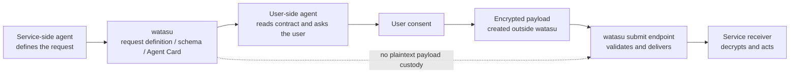

# watasu

[日本語版 README](README.ja.md)

watasu is an agent-native intake rail for publishing a machine-readable contract for personal-data intake and receiving encrypted submissions from external user-side agents.

Instead of building a human-facing form, a service publishes a request definition, JSON Schema, Agent Card, and A2A-compatible submit endpoint. watasu validates and forwards encrypted envelopes without decrypting payloads or keeping plaintext payload custody.

## Start here

If you are new to watasu, start with the Japanese user guide: [docs/user-guide.ja.md](docs/user-guide.ja.md).

This README is the project entry point. The user guide is the zero-background walkthrough. Product and engineering contracts live in [docs/prd-cli-mvp.md](docs/prd-cli-mvp.md), [docs/erd-cli-mvp.md](docs/erd-cli-mvp.md), and [docs/mvp-plan.md](docs/mvp-plan.md).

## Current status

As of 2026-06-15:

| Surface | Status | Try it |
| --- | --- | --- |
| Local Protocol MVP | Ready | `pnpm demo:handoff` |
| CLI | Ready | `pnpm --filter @watasu/cli watasu validate ...` |
| Local HTTP demo | Ready | `pnpm --filter @watasu/http demo` |
| Hosted API | Private-alpha ready | `https://api.watasu.ai/health` |
| Hosted MCP | Auth required | `/mcp` returns 401 without Bearer credentials |
| Human dashboard UI | Not in scope | Not part of the MVP |
| User-side personal vault / agent | Not in scope | Owned by another product or adapter |

Latest verified evidence:

- `pnpm loop` passed: typecheck, tests, secret scan, self-review preflight
- test suite passed: 35 test files, 402 tests
- `pnpm demo:handoff` returned `ok: true`
- handoff evidence showed `ledger_contains_payload_body: false`
- handoff evidence showed `response_contains_plaintext_payload: false`
- `pnpm --silent cutover:verify` returned `decision: "go"` for `https://api.watasu.ai`
- live `/health` returned `{"ok":true,"service":"watasu-hosted"}`
- hosted MCP returned unauthenticated `401` with `WWW-Authenticate`, as intended

## How it works



watasu owns the secure handoff rail:

- validate request definitions
- publish Agent Cards and schemas
- validate A2A HTTP+JSON submissions
- deliver encrypted envelopes to service receivers
- keep delivery evidence metadata-only

watasu does not own:

- human dashboard UI
- generic form builder
- user-side personal vault
- user-side agent / consumer AI companion
- legal consent, identity verification, delegated authority, regulatory compliance, or DSAR workflows

## Quick Start

```bash
pnpm install
pnpm loop
pnpm demo:handoff
```

Expected `pnpm demo:handoff` highlights:

```json
{
  "ok": true,
  "sender": {
    "payload_values_sent_to_watasu": false
  },
  "watasu": {
    "submit_status": 202,
    "delivery_status": "delivered",
    "ledger_contains_payload_body": false,
    "response_contains_plaintext_payload": false
  }
}
```

## CLI examples

Sample request definition:

```bash
packages/fixtures/requests/event-attendee.yaml
```

Common checks:

```bash
pnpm --filter @watasu/cli watasu validate packages/fixtures/requests/event-attendee.yaml
pnpm --filter @watasu/cli watasu schema packages/fixtures/requests/event-attendee.yaml
pnpm --filter @watasu/cli watasu publish packages/fixtures/requests/event-attendee.yaml --confirm
pnpm --filter @watasu/cli watasu agent-card packages/fixtures/requests/event-attendee.yaml --confirm
pnpm --filter @watasu/cli watasu ledger packages/fixtures/requests/event-attendee.yaml --confirm
pnpm --filter @watasu/cli watasu inspect-delivery packages/fixtures/requests/event-attendee.yaml --confirm
```

Send a local JSON payload through the sender fixture without printing payload values:

```bash
printf '{"full_name":"Alice Example","email":"alice@example.test"}' > /tmp/watasu-payload.json
pnpm --filter @watasu/cli watasu submit-fixture packages/fixtures/requests/event-attendee.yaml --payload /tmp/watasu-payload.json --confirm
```

`submit-fixture` is a local learning fixture. It is not a production submission flow.

## Local HTTP demo

```bash
pnpm typecheck
pnpm --filter @watasu/http demo
```

Default local routes:

- `http://127.0.0.1:8787/.well-known/agent-card.json`
- `http://127.0.0.1:8787/schemas/plaintext.json`
- `http://127.0.0.1:8787/schemas/envelope.json`
- `POST http://127.0.0.1:8787/submit`
- `http://127.0.0.1:8787/ledger`

Manual checks:

```bash
curl http://127.0.0.1:8787/.well-known/agent-card.json
curl http://127.0.0.1:8787/schemas/plaintext.json
curl http://127.0.0.1:8787/schemas/envelope.json
```

## Hosted private alpha

Production origin:

```text
https://api.watasu.ai
```

Public health check:

```bash
curl https://api.watasu.ai/health
```

Expected:

```json
{"ok":true,"service":"watasu-hosted"}
```

Hosted MCP metadata:

```bash
curl https://api.watasu.ai/.well-known/oauth-protected-resource
```

Hosted MCP transport:

```bash
curl https://api.watasu.ai/mcp
```

Without a Bearer token, `401` is the correct result.

Hosted publish and ledger operations run inside the private-alpha authenticated MCP / service identity boundary. This is not a public self-serve UI yet.

## Verification

Standard loop:

```bash
pnpm loop
```

`pnpm loop` runs `pnpm typecheck`, `pnpm test`, `pnpm lint`, and `pnpm review:self`.

Dependency, release-gate, or supply-chain changes require:

```bash
pnpm loop:full
```

Production cutover evidence:

```bash
pnpm --silent cutover:status
pnpm --silent cutover:verify
```

Treat private-alpha exposure as ready only when `cutover:verify` returns `decision: "go"`.

Operator cutover commands:

```bash
pnpm --silent deploy:preflight
pnpm --silent render:brief
pnpm --silent cutover:plan
pnpm --silent cutover:prepare
pnpm --silent cutover:repo
pnpm --silent cutover:status
pnpm --silent cutover:ci
pnpm --silent cutover:canary
pnpm --silent cutover:retention
pnpm --silent cutover:verify
pnpm --silent smoke:hosted
pnpm --silent secret:identity --plain
```

Cutover evidence is written to the gitignored `cutover-evidence/` directory. Main evidence files:

- `cutover-evidence/cutover-head.txt`
- `cutover-evidence/preflight.json`
- `cutover-evidence/smoke.json`
- `cutover-evidence/ci.json`
- `cutover-evidence/canary.json`
- `cutover-evidence/retention.json`

`pnpm --silent secret:identity --plain` prints only a 32 byte base64url secret value for Render. Use distinct values for `WATASU_SERVICE_IDENTITY_SIGNING_SECRET` and `WATASU_MCP_BEARER_TOKEN`, and enter real values only in the Render secret prompt. Do not put them in git, README, logs, or PR text.

## Documentation map

- [docs-site/](docs-site/): Rspress public docs source. `pnpm docs:build` generates a static site with `llms.txt` and `llms-full.txt`.
- [docs/user-guide.ja.md](docs/user-guide.ja.md): zero-background user guide
- [docs/mvp-plan.md](docs/mvp-plan.md): current status, manual checks, production cutover evidence
- [docs/prd-cli-mvp.md](docs/prd-cli-mvp.md): product requirements
- [docs/erd-cli-mvp.md](docs/erd-cli-mvp.md): engineering requirements
- [docs/protocol-baseline.md](docs/protocol-baseline.md): protocol and dependency baseline
- [docs/loop-engineering.md](docs/loop-engineering.md): Codex / gstack loop rules

Public docs site:

```bash
pnpm docs:build
pnpm docs:preview
```

Recommended hosting is Cloudflare Pages. Use build command `pnpm install --frozen-lockfile && pnpm docs:build`, output directory `doc_build`, and custom domain `docs.watasu.ai`.

## Security promise

watasu's boundary is **no payload custody**.

- watasu does not receive plaintext payloads
- watasu does not decrypt payloads
- watasu does not store plaintext payloads
- watasu does not put payload values in logs, README, or PR text
- watasu does not retain encrypted payload bodies after delivery attempts
- watasu does not keep a payload retry queue
- optional persistent ledgers must stay metadata-only

Passing tests is not a security proof. Security-boundary changes require the normal loop plus the relevant manual checks, secret scan, dependency audit, and gstack review.
