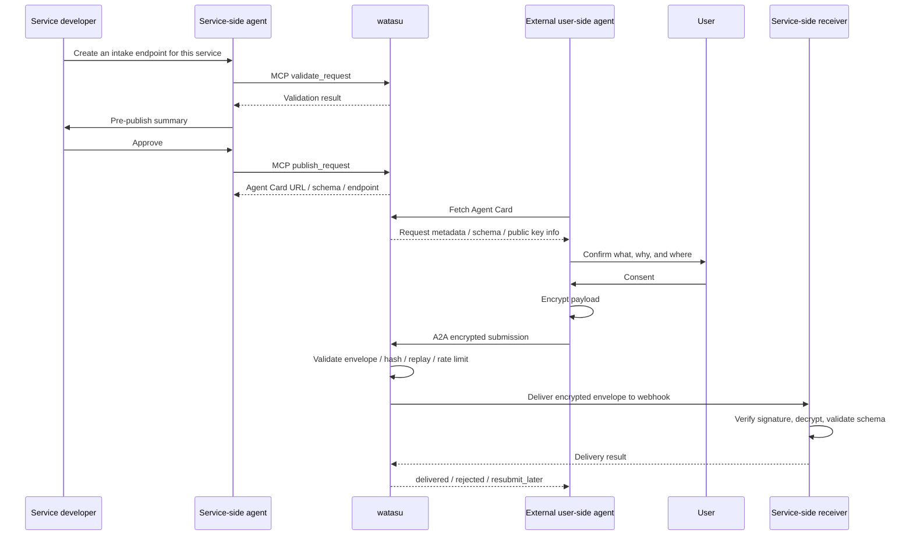

# watasu

[日本語版 README](README.ja.md)

watasu is an agent-native intake MVP for service-side agents to define requests for personal data and publish encrypted intake endpoints that external user-side agents can read.

Instead of building human-facing forms, watasu makes "what is being sent, why it is needed, and where it goes" machine-readable as a request definition, schema, and Agent Card. It provides the foundation for delivering encrypted submissions, based on user consent, to a service-side webhook.

## System Overview

The core flow mirrors the product contract in [docs/prd-cli-mvp.md](docs/prd-cli-mvp.md): service-side agents use MCP or the CLI to validate and publish a request; external user-side agents discover the Agent Card, confirm with the user, encrypt the payload, and submit through watasu. watasu validates and forwards the encrypted envelope without decrypting or keeping payload custody.



## Security Promise

watasu's boundary is **no payload custody**.

- watasu does not receive, decrypt, store, or log plaintext payloads.
- watasu does not hold the service private key.
- watasu does not retain encrypted payload bodies after a delivery attempt.
- If webhook delivery fails, watasu is designed to avoid keeping a payload retry queue and instead return `resubmit_later` to the sender.
- By default, watasu should avoid persistent custody even for metadata. Short-lived operational state may be kept for replay protection, rate limits, and sender-actionable delivery responses. Optional persistent ledgers must be metadata-only and explicitly enabled.

Because metadata can still be personal-related information, any optional persistent metadata is treated as subject to tenant, role, retention, and audit controls. watasu does not guarantee legal consent, identity verification, delegated authority, regulatory compliance, or DSAR handling. Those remain the responsibility of the service side or another product.

## Workspace Layout

```text
docs/
  prd-cli-mvp.md              Product requirements and scope
  erd-cli-mvp.md              Engineering requirements, protocol, data model
  protocol-baseline.md        Latest-info and dependency vetting record
  mvp-plan.md                 MVP stages, manual checks, execution phases
  loop-engineering.md         Codex loop template and verification rules
infra/
  postgres/                   Hosted PostgreSQL provisioning SQL artifacts
packages/
  core/                       Request validation, hashes, publish, schemas, A2A, delivery
  cli/                        File-based watasu CLI wrapper
  fixtures/                   Sample request definitions
  http/                       Local HTTP demo server
  mcp/                        MCP server package
  hosted/                     Production Node/PostgreSQL runtime package
scripts/                      Loop, review, PR, and secret-scan helpers
```

## Quick Start

```bash
pnpm install
pnpm typecheck
pnpm test
pnpm loop
pnpm demo:handoff
```

CLI examples:

```bash
pnpm --filter @watasu/cli watasu validate packages/fixtures/requests/event-attendee.yaml
pnpm --filter @watasu/cli watasu schema packages/fixtures/requests/event-attendee.yaml
pnpm --filter @watasu/cli watasu publish packages/fixtures/requests/event-attendee.yaml --confirm
pnpm --filter @watasu/cli watasu agent-card packages/fixtures/requests/event-attendee.yaml --confirm
pnpm --filter @watasu/cli watasu ledger packages/fixtures/requests/event-attendee.yaml --confirm
pnpm --filter @watasu/cli watasu inspect-delivery packages/fixtures/requests/event-attendee.yaml --confirm
```

To submit a local JSON payload through the sender fixture without printing payload values:

```bash
printf '{"full_name":"Alice Example","email":"alice@example.test"}' > /tmp/watasu-payload.json
pnpm --filter @watasu/cli watasu submit-fixture packages/fixtures/requests/event-attendee.yaml --payload /tmp/watasu-payload.json --confirm
```

## Local Demo

Build first, then start the local HTTP demo:

```bash
pnpm typecheck
pnpm --filter @watasu/http demo
```

Default server:

- `http://127.0.0.1:8787/.well-known/agent-card.json`
- `http://127.0.0.1:8787/schemas/plaintext.json`
- `http://127.0.0.1:8787/schemas/envelope.json`
- `POST http://127.0.0.1:8787/submit`
- `http://127.0.0.1:8787/ledger`

Manual checks:

```bash
curl http://127.0.0.1:8787/.well-known/agent-card.json
curl http://127.0.0.1:8787/schemas/plaintext.json
curl http://127.0.0.1:8787/schemas/envelope.json
```

For `POST /submit`, the local demo validates the A2A HTTP+JSON protocol gate, checks the encrypted envelope against the published fixture, delivers to a receiver fixture, and records metadata-only ledger rows. Use `Content-Type: application/a2a+json`, `A2A-Version: 1.0`, and `A2A-Extensions: https://watasu.dev/extensions/encrypted-intake/v1`.

For a no-server end-to-end handoff check, run:

```bash
pnpm demo:handoff
```

The handoff demo connects the local Agent Card, sender fixture, HTTP demo handler, receiver fixture, and metadata-only ledger in one process. Its JSON output should show `ok: true`, `ledger_contains_payload_body: false`, and `response_contains_plaintext_payload: false`.

## Verification Loop

Standard loop:

```bash
pnpm loop
```

`pnpm loop` runs `pnpm typecheck`, `pnpm test`, `pnpm lint`, and `pnpm review:self`.

Dependency, release-gate, or supply-chain changes require:

```bash
pnpm loop:full
```

Targeted checks:

```bash
pnpm typecheck
pnpm test
pnpm lint
pnpm review:self
pnpm exec vitest run packages/core/src/security-regression.test.ts
pnpm --filter @watasu/http test
```

Hosted canary after deploy:

```bash
pnpm canary:hosted -- https://api.watasu.ai
```

`pnpm lint` currently runs the repository secret-scan helper. It is intentionally narrow: passing tests is not treated as a security proof.

## Current MVP Status

See `docs/mvp-plan.md` for the recommended next actions, including manual checks you can run locally.

Local Protocol MVP is implemented and manually testable.

Currently implemented:

- pnpm workspace foundation for `@watasu/core`, `@watasu/cli`, `@watasu/fixtures`, and `@watasu/http`
- request definition parsing and validation
- sensitivity policy checks for high-risk and prohibited fields
- canonical JSON and SHA-256 hash helpers
- immutable in-memory request version publishing
- hosted publish ownership checks for service keys, webhook origins, HTTPS, and unsafe destination hosts
- in-memory service key and webhook origin ownership challenge lifecycle
- live HTTPS webhook ownership challenge fetching with DNS unsafe-address preflight
- DNS TXT webhook ownership challenge fetching
- hosted production request body size limiting before app delegation
- hosted publish HTTP adapter using server-side identity and ownership resolution
- plaintext payload schema and encrypted envelope schema generation
- A2A-compatible Agent Card generation
- A2A HTTP+JSON protocol gate
- submission envelope validation, replay/idempotency/rate-limit hooks, and payload hash checks
- request definition validation rejects private JWK material so service key custody stays outside watasu
- ES256 and Ed25519 EdDSA detached JWS sender signature verification for registered sender keys
- `verified_sender` and `private_invite` reject missing signatures, unresolved sender public keys, and invite-binding mismatches before delivery
- in-memory capability registry for revoke and rotate without mutating request versions
- webhook delivery helper with signed headers, a fetch-based HTTP adapter, and metadata-only ledger rows
- hosted webhook delivery re-checks DNS resolution before posting to reduce DNS rebinding / SSRF risk
- delivery timeout classification that returns `resubmit_later` without retaining payload bodies
- in-memory delivery circuit breaker for fail-fast `resubmit_later` after repeated webhook failures
- in-memory delivery concurrency limiter for request and tenant caps
- sender-actionable `resubmit_later` guidance with `Retry-After` and no payload retry queue
- local HTTP demo wiring for injected delivery circuit breaker and concurrency limiter hooks
- fetch delivery adapter disables automatic redirects; hosted delivery manually follows at most one SSRF-checked safe redirect
- storage policy boundary for stateless-by-default delivery and opt-in metadata ledger writes
- metadata ledger read authorization helper with tenant, role, and audit checks
- hosted metadata ledger HTTP adapter that resolves service identity server-side
- hosted production HTTP app that composes publish and metadata routes
- hosted request-specific Agent Card route for published request versions
- hosted A2A submit route for validating and delivering encrypted submissions without retaining payload bodies
- hosted submit sender-trust resolver hook for `verified_sender` and `private_invite` authentication boundaries
- low-information hosted `/health` endpoint for deployment health checks
- hosted HTTP security headers for low-information API responses
- hosted production bootstrap app that shares trusted identity, ownership, and metadata wiring
- hosted production Node HTTP server factory and runtime env parser
- hosted production binary through `@watasu/hosted`
- hosted signed service identity header resolver for deployment identity provider boundaries
- trusted service identity resolver for mapping authenticated server context into hosted roles
- hosted sender trust resolver for registered sender keys and private invite bindings
- in-memory sender key registration, revocation, and rotation lifecycle
- in-memory verified service public key registration, revocation, and rotation lifecycle
- JSONL delivery metadata ledger store for opt-in local persistence
- PostgreSQL-compatible delivery metadata ledger store for hosted persistence
- PostgreSQL delivery metadata ledger schema SQL for hosted migration bootstrap, including same-idempotency retry attempt rows
- PostgreSQL delivery metadata ledger migration runner for injected hosted query clients
- PostgreSQL metadata ledger provisioning SQL artifact for hosted infrastructure setup
- hosted PostgreSQL runtime config parser and migrated ledger store factory for injected pool clients
- hosted Node/PostgreSQL runtime package with bounded pool config and query adapter
- hosted signed-header identity provider runtime config for production entrypoints
- hosted Postgres retention command for scheduled metadata cleanup
- metadata ledger retention helper for deleting expired delivery metadata without exposing payload bodies
- hosted metadata retention job runner gated by auditor role
- flattened JWE JSON payload encryption/decryption wrapper with fixed algorithm allowlist
- MCP server package with a read-only request definition validation tool
- MCP publish tool plus read tools and resources for Agent Card, plaintext schema, envelope schema, and metadata-only ledger rows
- hosted MCP publish and ledger tools that delegate to the hosted production app
- hosted MCP transport service-header resolver that rejects unauthenticated hosted tool calls before app delegation
- hosted MCP OAuth protected-resource metadata and WWW-Authenticate challenge helpers
- hosted MCP Streamable HTTP entrypoint guard for path, Origin, Bearer auth, and protocol version
- Render Blueprint for the first `api.watasu.ai` web service, managed PostgreSQL database, and metadata retention cron
- GitHub Actions CI gate for Render `checksPass`
- hosted canary script for `/health`, unpublished Agent Card / submit routes, leak fragments, security headers, and HTTPS production URLs
- sender and receiver fixtures for local A2A handoff checks
- file-based CLI wrappers and a local HTTP demo

Repo-side Hosted Production MVP library/runtime building blocks are now present, and the first deployment-facing slice exists for `api.watasu.ai` with a health-checkable web service, request-specific Agent Card and A2A submit routes for published request versions, Blueprint-managed PostgreSQL, and scheduled metadata retention. Render workspace/billing setup, DNS verification, TLS issuance, and real secret values remain deployment follow-up work.

Not in scope for the MVP:

- dashboard UI or human form builder
- user-side agent, personal vault, or consumer AI companion

See `docs/prd-cli-mvp.md`, `docs/erd-cli-mvp.md`, and `docs/mvp-plan.md` for the deeper product and engineering contract.
