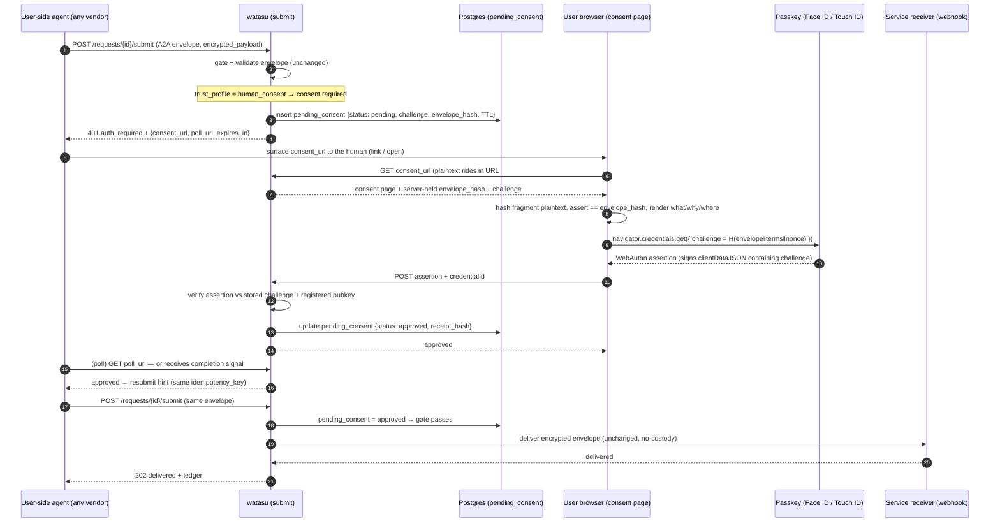

# Consent Gate — Design Note (v1)

> Status: proposal, 2026-07-04; **revised 2026-07-05 for tap's retirement** (watasu is now a
> standalone product, not tap's relay half — §1). Adds a **runtime human-consent gate** to
> watasu's submit flow: an agent's submission pauses, a human approves it in a plain browser
> with a passkey signature bound to the exact payload, watasu stores a hash-only receipt, and
> the agent's request resumes. No app install on the user side; no change to the no-custody
> boundary.

## 1. Decision: watasu is a standalone product; the gate lives entirely in watasu

**Resolved 2026-07-05: the `tap` project is retired. watasu is no longer "the
server-side/relay half of tap" — it is the standalone Nexepia product, and it now owns
BOTH halves of the flow the gate needs: the agent-pause trigger *and* the human consent
ceremony.** (Historical note: an earlier version of this doc, 2026-07-04, framed the gate as
a bridge across watasu + tap, and a 2026-07-05 revision planned a "full conversion onto tap's
PWA." Both are dead — see the retirement notes in §11 and §12.)

- **watasu already owns the hard 80%** the feature sits on: A2A 1.0 HTTP+JSON intake, the
  no-custody relay, envelope validation, hashing, idempotency, SSRF-guarded delivery, the
  metadata ledger, and the MCP + CLI operator surface — all deployed on Render. The consent
  gate is a **single insertion** at a known point in `hosted-submit.ts`.
- **watasu owns the consent surface itself** — a watasu-hosted static consent page (§2, §6),
  not a handoff to an external PWA. No second stack, no cross-repo coordination.
- The gate adds a distinct runtime field **`consent_receipt_token`** on the envelope
  (`packages/core/src/submission.ts`). It briefly coexisted with an upstream *static*
  `consent_receipt` / `consent_receipt_hash` attestation (Sota's personal-info adapter,
  PRs #81–87); that static path has since been removed on this branch — see §13.
- The genuinely new part — **browser passkey/WebAuthn signing over a payload** — is built
  fresh on watasu's own consent page (§4–§7).

**Identity / regulated tier now lands on watasu too.** The credential-grade upgrade
(OID4VP / SD-JWT-VC / KB-JWT / mdoc, §9) was previously going to lean on tap's `@tap/schema`
+ sealed signing-worker. With tap retired, **watasu owns that tier**: a durable credential
store and a watasu-minted, watasu-signed credential receipt are now legitimate, expected
parts of the product (the DB-less "just a relay" posture was a relic of the old framing —
see §6). The receipt-format *source* is an open decision (§9, §11).

Stack note: watasu is a Node/Render project. A future migration to Cloudflare Workers is now
a purely internal watasu choice (no longer tied to merging with tap's Workers stack) — decide
on its own merits.

## 2. Scope of v1

In scope:

- One consent-gated trust profile (new `trust_profile` value, e.g. `human_consent`), so
  existing `public_capability` / `verified_sender` / `private_invite` flows are untouched.
  **Update (2026-07-05):** those three profiles were subsequently *removed* — watasu is a
  human-approved personal-info relay, so `human_consent` is the sole real profile (plus
  `local_demo` for dev). Machine sender-trust / invite machinery was deleted with them.
- Pause via A2A `auth_required` + an RFC 8628-style device-flow body.
- A hosted consent web page (static, no install) that renders what/why/where, takes a plain
  WebAuthn assertion, and posts it back.
- A hash-only consent receipt persisted alongside the delivery ledger, ISO 27560-shaped.
- Resume via completion signal **and** poll fallback.

Out of scope for v1 (tracked in §9): OID4VP/KB-JWT credential receipts, MCP URL-mode
elicitation client integration, CIBA/push, tiered "consent once vs every time" policy.

## 3. Flow



Note on resume: the MCP URL-mode elicitation spec (SEP-1036) itself does **not** guarantee
the completion notification is delivered, so polling is not optional — it is the floor. The
completion signal is only the fast path.

## 4. Insertion points (real references)

| Concern | File | What changes |
| --- | --- | --- |
| Gate the submit flow | `packages/http/src/hosted-submit.ts:180` | Between `validateSubmissionEnvelope` (`:172`) and `deliverAcceptedSubmission` (`:180`), branch on consent state. |
| Runtime receipt field | `packages/core/src/submission.ts` (`consent_receipt_token`) | New field, distinct from upstream's static `consent_receipt` / `consent_receipt_hash` (§13). |
| New trust profile | `packages/core/src/request-definition.ts` (`trust_profile`), `hosted-submit.ts` | `human_consent` is now the sole real profile (`local_demo` for dev); the `public_capability`/`verified_sender`/`private_invite` profiles and their sender-trust machinery were removed (2026-07-05). |
| Persistence pattern to copy | `infra/postgres/metadata-ledger.sql`, `packages/core/src/delivery.ts` (ledger row types), `packages/hosted/src/index.ts` (Postgres wiring + retention) | Add a parallel `pending_consent` table + store + retention. |
| Consent surface (new) | new `packages/http` routes + a static page | `GET /requests/{id}/consent/{token}`, `POST …/consent/{token}/approve`. |
| WebAuthn verify (new) | new `packages/core/src/webauthn.ts` | Verify assertion; `jose`/`node:crypto` already present, no new heavy dep. |

## 5. Concrete gate sketch (`hosted-submit.ts`)

Illustrative, not final — inserted right after the existing `validationResult` block
(current `:172–178`) and before `deliverAcceptedSubmission` (`:180`):

```ts
// ... after validateSubmissionEnvelope succeeds (hosted-submit.ts:172-178) ...

if (published.definition.trust_profile === "human_consent") {
  const consent = await input.consentStore.lookup({
    tenantId,
    requestId: published.request_id,
    idempotencyKey: gateResult.envelopeCandidate.idempotency_key,
    now: input.clock()
  });

  if (consent.status !== "approved") {
    // First hit (or still pending): create/refresh the pending row and pause the agent.
    const pending = await input.consentStore.upsertPending({
      tenantId,
      requestId: published.request_id,
      idempotencyKey: gateResult.envelopeCandidate.idempotency_key,
      envelopeHash: gateResult.envelopeCandidate.encrypted_payload_hash,
      consentTextHash: published.consent_text_hash,
      now: input.clock()
    });
    return jsonResponse(401, {
      ok: false,
      status: "auth_required",
      consent: {
        consent_url: `${input.publicBaseUrl}/requests/${encodeURIComponent(
          published.request_id
        )}/consent/${pending.token}`,
        poll_url: `${input.publicBaseUrl}/requests/${encodeURIComponent(
          published.request_id
        )}/consent/${pending.token}/status`,
        expires_in: pending.expires_in_seconds
      }
    });
  }

  // Approved: bind the runtime receipt to the envelope the human actually saw.
  if (consent.receiptEnvelopeHash !== gateResult.envelopeCandidate.encrypted_payload_hash) {
    return jsonResponse(400, {
      ok: false,
      status: "rejected",
      error: {
        code: "consent_envelope_mismatch",
        message: "Approved consent does not match this payload.",
        path: "body.message.parts[0].data.encrypted_payload_hash"
      }
    });
  }
  // fall through to deliverAcceptedSubmission unchanged
}

const deliveryResult = await deliverAcceptedSubmission({ /* unchanged */ });
```

`auth_required` (HTTP 401) is already a first-class status here (`hosted-submit.ts:173`), so
the pause path reuses existing plumbing rather than inventing a new status.

## 6. Pending-consent state — stateless signed token (NOT a table)

**Correction (2026-07-05): the deployed web tier is DB-less by construction.**
`createHostedProductionServerFromEnv` (`packages/hosted/src/index.ts:202-207`) forces the
metadata ledger `disabled` and forbids `WATASU_POSTGRES_URL`; the bootstrap defaults to
`InMemoryRequestVersionRepository` / `InMemoryIdempotencyStore` / noop ledger. Postgres is
only wired in the separate retention-job process. A `watasu_pending_consent` table would be
watasu's first web-tier database and fights that posture. Prefer the stateless approach.

**Preferred: encode the pending consent as a signed, opaque token.** No table; watasu holds
nothing between pause and approval.

- On pause, watasu mints `consent_token = JWS/JWE({ tenant_id, request_id, request_version,
  idempotency_key, envelope_hash, consent_text_hash, nonce, exp })` signed with the existing
  service-identity secret (reuse `deliverySigningSecret`; `jose` already a dep). The agent
  carries it in `consent_url`; the token *is* the row.
- On approval, watasu verifies the token signature + `exp`, checks the WebAuthn assertion
  against `challenge = SHA-256(envelope_hash ‖ consent_text_hash ‖ nonce)` (all recovered
  from the token — no lookup), and mints a signed `consent_receipt_token` (a watasu-native
  JWS in v1; watasu-owned KB-JWT credential shape in the deferred upgrade, §9) that the agent
  presents on resume.
- The only durable need is **single-use / replay protection** ("has this consent_token been
  spent"), which rides the existing `IdempotencyStore` abstraction
  (`packages/http/src/hosted-submit.ts:48`). Single Render instance: in-memory is adequate
  for v1; multi-instance later: swap a durable `IdempotencyStore` impl (the one seam that may
  eventually want Redis/KV — nothing else).

(A server-side `watasu_pending_consent` Postgres table was considered and dropped — it would
be watasu's first web-tier database and fights the DB-less posture. The signed token replaces it.)

## 7. No-custody preservation (the load-bearing detail)

The consent page must *show* the data, but watasu must never see plaintext. Resolution:

- The user-side agent puts the plaintext in the **URL fragment** (`consent_url#<payload>`).
  Fragments are never sent to the server by browsers, so watasu's request logs and handlers
  never receive it.
- The page hashes the fragment client-side and asserts it equals the `envelope_hash` the
  server *does* hold (from the encrypted envelope). Mismatch ⇒ refuse to render.
- The WebAuthn challenge is `SHA-256(envelope_hash ‖ consent_text_hash ‖ server_nonce)`, so
  the biometric signs over *what the user saw*, not a bare random challenge.
- Only the assertion + `credential_id` + a derived `receipt_hash` are persisted. No payload,
  no plaintext — identical posture to `watasu_delivery_ledger`.

This keeps the PRD/ERD invariant intact (`docs/prd-cli-mvp.md` "No payload custody";
`docs/erd-cli-mvp.md` no-custody clauses).

## 8. Spec versions pinned (verified mid-2026)

- **A2A 1.0.1** (2026-05-28; major 1.0.0 was 2026-03-12, breaking). watasu already targets
  `"1.0"` (`packages/core/src/a2a.ts`) — confirm alignment to the 1.0.x line.
- **MCP URL-mode elicitation: SEP-1036, Final**, spec revision 2025-11-25; next revision is a
  2026-07-28 release candidate. (Integration is v2 — §9.)
- **WebAuthn Level 3**: W3C Candidate Recommendation Snapshot, 2026-01-13 (not yet final REC).
  Plain `navigator.credentials.get()` challenge-binding is the sound v1 practice; there is
  **no** browser-native non-payment transaction-display extension (`txAuthSimple` deferred to
  L4), and **Secure Payment Confirmation is payments-only** and cannot be called directly via
  `navigator.credentials.get()` — so SPC is a design template, not a component.
- **ISO/IEC TS 27560** consent-record format: W3C DPVCG implementation guide reached Final
  Community Group Report 2026-02-15 — the citable schema for the receipt.

## 9. Upgrade path & deferred work

- **Credential-grade receipts — watasu-owned, deferred past v1.** v1 ships the watasu-native
  signed receipt token (§6); the upgrade is a credential-grade receipt (OID4VP 1.0
  `transaction_data` + SD-JWT-VC KB-JWT per RFC 9901). With tap retired (§1), **watasu mints
  and signs this itself** rather than depending on tap's `@tap/schema` / signing-worker.
  Separation of concerns still holds: the **passkey assertion** is the signing gesture (plain
  WebAuthn — no browser-native OID4VP signing exists yet, §8); the **receipt** is the record,
  wrapped in a KB-JWT credential shape. **Open decision (§11):** where watasu's SD-JWT-VC /
  KB-JWT implementation comes from — vendor/fork the (retired) `@tap/schema` pure-TS code into
  a watasu package, or build on generic libs (`jose`, `@noble/*`). EUDI KB-JWT mandate:
  2026-12-24.
- **MCP-native trigger:** emit `URLElicitationRequiredError` (-32042) for MCP clients that
  advertise URL-mode elicitation, in addition to the A2A/device-flow body.
- **Push resume (CIBA):** later; requires an authenticator app → violates no-install for v1.
  Track IETF `draft-klrc-aiagent-auth-01` (Ping/OpenAI/AWS/Zscaler, 2026-03).
- **Tiered consent** ("core once vs per-visit"): borrow EUDI "overasking protection"
  vocabulary; explicitly deferred — v1 confirms every submission.

## 10. Competitive note

**Arcade.dev** (authored SEP-1036; $60M Series A 2026-06-15) owns the agent-authorization
*trigger* primitive but does OAuth token brokerage for agents accessing *services* — not
payload-signed consent for personal-data *submission*. **Auth0 Auth for AI Agents** ships
CIBA async approval, enterprise/push-shaped. Neither does hosted, passkey-signed,
no-custody consent for agent-mediated personal data — the slot this gate targets. The wedge
is the **signed receipt + no-custody relay**, not the trigger (which the spec + Arcade
commoditize).

## 11. Open decisions

1. **Ownership — RESOLVED 2026-07-05: `tap` is retired; watasu is the standalone product**
   (§1). The former "coordinate with Sota / tap Loop-1 freeze / confirm A2A wire alignment
   with tap / receipts share `@tap/schema`" items are all moot — there is no second half to
   interoperate with. Nexepia ownership is unchanged (Sota's startup); this is now
   watasu-internal work.
2. **Passkey registration UX:** first approval requires creating a passkey (one tap, still no
   install). Belongs in the demo script so it isn't discovered live.
3. **Desktop agent / phone passkey:** rely on WebAuthn hybrid (QR/CTAP2) transport; adds a
   hop — acceptable for v1?
4. **Consent surface — RESOLVED 2026-07-05: a watasu-hosted static consent page** (§2, §6),
   not an external PWA. (Supersedes the 2026-07-04→05 "full conversion onto tap's PWA" plan,
   now dead with tap's retirement — see §12.)
5. **Credential-receipt format source (deferred, §9):** when the credential-grade upgrade is
   built, does watasu vendor/fork the retired `@tap/schema` pure-TS SD-JWT-VC / KB-JWT code
   into its own package, or build on generic libs (`jose`, `@noble/*`)? Decide at that time.
6. **Migrate to Workers?** Now a standalone watasu question (no longer tied to merging with
   tap) — decide on its own merits if/when Render becomes a constraint.

## 12. ~~Full-conversion ledger (KEEP / DELETE / CHANGE)~~ — OBSOLETE (tap retired 2026-07-05)

This section planned a full conversion that would fold tap's PWA, `packages/schema`,
signing-worker, and verifier Worker into one agent-mediated pipeline (deleting tap's
physical-NFC entry and client-side lite-wallet). **It is obsolete: `tap` was retired outright
on 2026-07-05, so there is nothing to convert.** watasu is standalone and owns the whole flow
directly (§1). What survives conceptually:

- The **consent surface is watasu-native** (§2, §6) — no tap PWA to rewire.
- watasu **owns delivery, discovery / Agent Card, and service onboarding** (`publish`)
  outright — the old "consolidate with tap's fanout / console" questions are gone.
- The **credential / receipt tier is watasu-owned** (§9); if tap's `@tap/schema` pure-TS code
  is still useful, it would be *vendored into watasu*, not depended on across repos (§11.5).

The original KEEP / DELETE / CHANGE ledger has been removed to avoid implying tap work is
still pending; see this doc's git history (pre-2026-07-05) if that detail is ever needed.

## 13. Reconciliation with upstream's `consent_receipt` (surfaced by the rebase)

Rebasing onto current `main` collided on the name `consent_receipt` — because **Sota already
built a consent mechanism on watasu** (PRs #81–87, 2026-06-15, the personal-info adapter).
The branch's runtime field was renamed to `consent_receipt_token` to coexist. But the
collision is not just a name clash; it exposes **two different philosophies of where consent
lives**, and that is the real thing to reconcile with Sota before this merges.

### The two mechanisms

| | Upstream `consent_receipt` (Sota, shipped) | This gate `consent_receipt_token` (proposed) |
|---|---|---|
| Type | `ConsentReceiptMetadata` (`submission.ts:33-39`): request_version + 3 hashes + `confirmed_at` | Compact JWS runtime token (`consent.ts`) |
| Who confirms | The **user's agent / adapter**, before submitting | The **human**, live, at the watasu boundary |
| Where consent happens | **Client-side**, pre-submission (a local `--confirm` CLI flag in the adapter) | **Server-mediated**, at submission (browser passkey) |
| What watasu checks | Hash-equality only — receipt matches the published version's hashes (`validateConsentReceiptMetadata`, `submission.ts:466-519`) | WebAuthn signature over the payload-bound challenge |
| Proves a human consented? | **No** — no signature; anyone with the public Agent Card can forge a structurally-valid receipt. It proves *freshness / version-pinning*, not consent. | **Yes** — passkey signature bound to `envelope_hash` |
| Pauses the agent? | No — validated inline, fully automated | Yes — `auth_required` → approve → resume |

### The conflict to resolve

Sota's own integration brief (`docs/personal-info-mcp-integration-brief.md`, lines 72-78)
**explicitly scopes human consent OUT of watasu**: watasu does *not* own "user consent UI,"
"human dashboard UI," or "model-calling loops for user decisions" — the sender-side adapter
owns "asking the user to confirm." This consent gate does the **opposite**: it puts a live,
enforceable human-approval surface *inside* watasu's boundary.

So the two aren't redundant — they're a genuine architectural disagreement:

- **Sota's model** is simpler and keeps watasu thin, but its consent signal is
  **unenforceable** — watasu cannot prove a human ever confirmed (the `--confirm` flag is
  invisible to watasu; the receipt is forgeable).
- **This gate** is heavier (watasu hosts a consent surface) but produces an **enforceable,
  signed** consent receipt.

### Decision (2026-07-05): tiebreaker is legal validity → the signed runtime mechanism

The chosen criterion is **which mechanism actually works for legally-valid personal-data
collection between agents.** On that axis the signed runtime mechanism wins decisively, and
the static receipt is *not* a substitute.

**Why the static `consent_receipt` fails as consent evidence.** Legal consent must be
**demonstrable** (GDPR Art. 7(1)) and **recorded** for third-party provision (Japan APPI
第三者提供 記録義務 — watasu relaying user data to a service is exactly this). The static
receipt is attached by the **sending agent itself**, unsigned, unwitnessed, and forgeable
(all inputs are public hashes + a timestamp). It proves the *terms were current*
(version-pinning) — it does **not** prove a human consented, nor attribute the act to the data
subject. In an agent-mediated flow, no neutral party witnessed the consent, so the service
(the controller) cannot demonstrate it. That is not legally sufficient consent evidence.

**Why the signed mechanism works.** A **neutral surface witnesses and records** the data
subject's approval at submission, with a **passkey signature** for non-repudiation and
attribution. That is a defensible consent artifact.

**Do NOT keep both — the signed receipt subsumes the static one.** The static receipt's only
genuine legal contribution is *terms integrity* (specific/informed binding to the exact
consent text, field purposes, destination policy). Fold those three hashes into the signed
challenge, and the single signed receipt proves *both* "consent was to the correct terms" and
"a human consented." One mechanism; the static path is retired for the personal-data case.

**This settles the architectural conflict.** You cannot obtain legally-robust, service-
trustable consent purely client-side via an unenforceable `--confirm` — there is no neutral
witness and no attribution. So the "consent UI is out of watasu's scope" position does not
meet the legal bar. The neutral consent surface lives in **watasu itself** (tap retired, §1)
— what is ruled out is the static self-asserted receipt as the consent basis.

**Scaling to regulated data.** A passkey proves "a controlling human consented" + non-
repudiation, but not "verified legal identity X." For identity-bound consent (KYC,
要配慮個人情報, government forms — the Japan mdoc/National-ID wedge), bind the credential to a
**verified identity credential**: OID4VP + SD-JWT-VC KB-JWT tied to an EUDI wallet or Japan's
mdoc National ID (the §9 upgrade path).

> **Not legal advice.** Confirm per jurisdiction (GDPR vs APPI 記録義務 vs US state laws; sensitive
> data raises the bar) before relying on this. Concrete question for Sota's legal contacts:
> *"For agent-mediated collection of personal data, is an unsigned agent-attached receipt
> sufficient consent evidence, or is a signed/witnessed approval required?"*

### Implemented (2026-07-05, commit `137e7cb`)

The consolidation is done on this branch, green (only the 4 known-pre-existing upstream
failures, zero new):

- **Removed** the static path: `ConsentReceiptMetadata`, `validateConsentReceiptMetadata`, the
  optional `consent_receipt` envelope field + schema property, and their tests.
- **Token now binds all three term-hashes.** `buildConsentChallenge` hashes
  `envelope_hash ‖ consent_text_hash ‖ field_purposes_hash ‖ destination_policy_hash ‖ nonce`,
  so the passkey signs over the exact terms + purposes + destination + payload. The gate
  re-pauses if a resume receipt's term-hashes don't match the published version.
- **`consent_receipt_hash` kept** as a *minimal required terms echo* (must equal the published
  `consent_text_hash`) — it's load-bearing (sender-signature coverage, type guard, schema,
  ~20 files), and it only pins terms; it is explicitly **not** consent evidence (that's the
  token). Full removal was out of scope for this pass.
- **`personal-info-adapter` (Sota's) — removed entirely.** Rather than rewire the adapter to
  mint/carry a `consent_receipt_token` through the interactive passkey gate, the whole
  `personal-info-adapter` package was deleted from this fork — it was a zero-dependent leaf with
  no callers, and its headless submit path could no longer produce an enforceable consent
  artifact under the token-based gate anyway. There is no adapter left to rewire; a
  headless→interactive `human_consent` client would need to be built fresh against the token
  gate if that path is ever wanted again.
