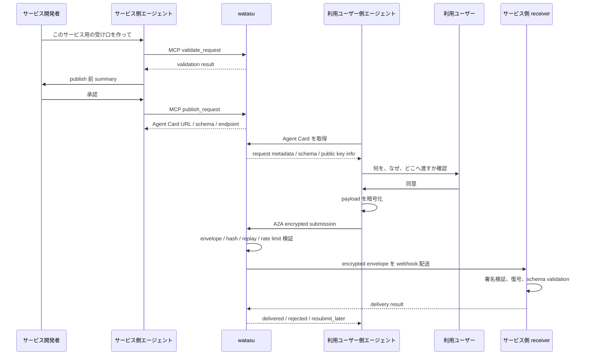

# watasu PRD: Agent-native personal data intake

## 0. 初めて読む人へ

この PRD は、A2A、MCP、Agent Card、JWE、validate、publish、payload などの用語を知らない人でも読めるように、最初に watasu のしくみと主要用語を説明する。詳細な wire format、DB schema、contract tests は `docs/erd-cli-mvp.md` に置く。

## 0.1 用語集

| 用語 | 説明 |
| --- | --- |
| intake | データの受け取り口。watasu では、個人データをフォームではなくエージェント経由で受け取る仕組み全体を指す。 |
| agent-native | 人間の画面操作ではなく、エージェントが読んで操作できることを最初から前提にした設計。 |
| agent | AI などがユーザーや開発者の代わりに作業する主体。watasu のMVPが提供するのは主にサービス側エージェント向け操作面で、利用ユーザー側エージェント本体は別プロダクトの責務。 |
| service-side agent | サービス開発者を手伝うエージェント。request definition を作り、validate / publish する。 |
| user-side agent | 利用ユーザーの代理で動く外部エージェント。Agent Card を読み、ユーザーに確認し、payload を暗号化して送るが、watasu MVP の提供スコープ外。 |
| MCP | Model Context Protocol。AI アプリやエージェントが外部の tool や data source を呼ぶための共通ルール。watasu ではサービス側エージェントが request を validate / publish する入口。 |
| A2A | Agent2Agent Protocol。別々の agent 同士が相手を発見し、メッセージを送り、作業を進めるための共通ルール。watasu では利用ユーザー側エージェントが intake endpoint に submission する入口。 |
| CLI | Command Line Interface。ターミナルから実行するコマンド操作の入口。MVP では MCP と同じ操作をローカル検証できるようにする。 |
| tool | エージェントが呼び出せる操作。例: `validate_request`、`publish_request`。 |
| validate | 内容がルールに合っているか検証すること。watasu では request definition、schema hash、envelope などを確認する。 |
| publish | 検証済みの request を公開し、Agent Card、schema、submission endpoint を発行すること。 |
| request | サービス側が「どの個人データを、なぜ、どこへ送ってほしいか」を定義した要求。 |
| request definition | request の中身を YAML / JSON などで書いた機械可読の要求文書。 |
| request version | 公開済み request definition の固定版。一度公開した version は書き換えず、変更時は新 version を作る。 |
| field | 要求するデータ項目。例: 氏名、メールアドレス、アレルギー情報。 |
| purpose | field を何のために使うかという利用目的。例: イベント受付、連絡、安全確認。 |
| schema | データの形を定義するルール。どの field が必要か、型は何か、形式は何かを表す。 |
| payload | ユーザーがサービスへ渡す個人データ本文。watasu は payload を復号せず、保存もしない。 |
| plaintext payload | 暗号化されていない payload。watasu は plaintext payload を受け取らない、保存しない、log に出さない。 |
| encrypted payload | 暗号化済みの payload。watasu は配送時に扱うが、delivery attempt 後は body を保持しない。 |
| envelope | payload と request id、schema hash、consent receipt hash などをまとめた配送用の封筒。 |
| submission | 利用ユーザー側エージェントが watasu に送る提出データ。encrypted payload と metadata を含む。 |
| endpoint | HTTP などでデータを送る先の URL。watasu では submission endpoint や webhook endpoint がある。 |
| Agent Card | agent や agent-like endpoint の自己紹介カード。「何ができるか」「どこに送るか」「どんな形式を受け付けるか」を JSON で伝える。 |
| webhook | サービス側が用意する HTTP の受け口。watasu は encrypted envelope を webhook に配送する。 |
| receiver | webhook を受け取るサービス側の処理。署名を検証し、payload を復号し、schema validation を行う。 |
| delivery | watasu が encrypted envelope をサービス側 webhook に届けること。 |
| retry | 失敗した処理をもう一度試すこと。MVP では watasu が payload を保存して後続 retry せず、sender に `resubmit_later` を返す。 |
| sender | submission を送る主体。通常は利用ユーザー側エージェント。 |
| consent | ユーザーが「何を、なぜ、どこへ渡すか」を確認して同意すること。 |
| consent receipt | ユーザー同意の技術的な証跡。法的に完全な同意ではなく、どの request version / consent text / field purpose / destination policy に紐づいた submission かを検証するための metadata。 |
| metadata | payload 本文ではない補助情報。例: request id、version、hash、delivery status、timestamp。組み合わせると個人関連情報になり得る。 |
| retention | データや metadata をどのくらい保持するかという保持方針。 |
| ledger | 配送台帳。MVP の default では永続化せず、必要な場合だけ optional metadata-only ledger として有効化する。payload 本文は保存せず、配送 status、request version、hash、error category などの metadata だけを扱う。 |
| hash | データから作る短い検証用の値。中身そのものを保存せず、改ざんや一致確認に使う。 |
| signature | 送信者や配送元が本物か、内容が改ざんされていないかを確認するための署名。 |
| key | 暗号化や署名に使う鍵。watasu は service private key を持たない。 |
| public key | 公開鍵。payload を暗号化するために利用ユーザー側エージェントへ公開してよい鍵。 |
| private key | 秘密鍵。payload を復号するためにサービス側だけが持つ鍵。 |
| fingerprint | 鍵やschemaなどを識別するための短い指紋。人間が公開前 summary で確認できる。 |
| JWE / JWK | JWE は JSON Web Encryption、JWK は JSON Web Key。watasu では payload を JSON 互換の暗号化形式で包み、公開鍵を JSON で扱う。 |
| capability URL | URLを知っていること自体がアクセス権になる高エントロピーURL。漏れた場合に備えて revoke できる必要がある。 |
| revoke / revocation | 一度発行した URL や権限を無効化すること。 |
| rate limit | 短時間に大量送信されないよう送信回数を制限すること。webhook DoS や台帳汚染を防ぐ。 |
| idempotency key | 同じ送信を重複処理しないためのキー。retry や replay protection に使う。 |
| replay protection | 過去の submission を再送して不正に処理させる攻撃を防ぐ仕組み。 |
| log | システムが動作記録として残す情報。watasu は plaintext payload を log に出さない。 |
| DB | Database。watasu の default path では DB 永続化を必須にしない。永続化を有効化する場合も payload 本文をDBに保存せず、明示的に許可した metadata だけを保存する。 |
| reference sender fixture | A2A submission contract を検証するための固定サンプル送信器またはfixture。本物の user-side agent ではない。 |
| fixture | テストやデモで使う固定サンプルデータ。実ユーザーの個人データではない。 |
| auth_required | sender authentication や sender signature が必要なのに不足している状態。 |
| resubmit_later | watasu が payload を保存して retry せず、sender に後で再送してもらうための応答。 |

MCP と A2A の違い:

| 観点 | MCP | A2A |
| --- | --- | --- |
| 主な相手 | agent と tool / data source | agent と agent |
| watasu での用途 | サービス側エージェントが watasu を操作する | 利用ユーザー側エージェントが intake endpoint に送る |
| 例 | `publish_request` を呼ぶ | encrypted submission を送る |
| 注意点 | tool 実行なので確認と権限管理が大事 | agent 間通信なので発見、認証、状態管理が大事 |

## 1. 概要

watasu は、人間向けフォームの代わりに、サービス側エージェントが個人データの要求定義と暗号化 intake endpoint を作れるようにする agent-native intake product。

サービス側エージェントは「どの個人データを、何の目的で、どこに受け取りたいか」を要求定義として作る。外部の利用ユーザー側エージェントは、その要求を読み、ユーザー同意にもとづいて暗号化 submission を送る。watasu は A2A 互換の受け口を公開し、暗号化された submission をサービス側へ配送する。payload 本文は復号も保存もしない。

MVP は CLI / MCP で完結する。人間用回答フォーム、回答一覧画面、dashboard UI、ユーザー vault、ログイン、非エンジニア向け UI、利用ユーザー側エージェント本体は作らない。

## 1.1 しくみの概要

watasu の中心アイデアはシンプルである。

1. サービス側が「どんな個人データが必要か」を機械が読める形で公開する。
2. 外部の利用ユーザー側エージェントがその要求を読み、ユーザーに確認する。
3. ユーザーが同意したら、外部の利用ユーザー側エージェントがデータを暗号化して送る。
4. watasu は暗号化された封筒をサービス側に届ける。
5. watasu は payload 本文を読まない。保存もしない。

## 2. プロダクトの一文

サービス側エージェントが個人データの要求定義を作るだけで、利用ユーザー側エージェントが読める暗号化 intake endpoint を公開できる。

## 3. 背景と課題

これまでの Web では、個人データの受け渡しは人間向けフォームが中心だった。ユーザーは氏名、メール、住所、職歴、健康情報、希望条件などを何度も手入力し、サービス側はフォーム、一時 DB、CSV export、同意文、配送処理、ログ、セキュリティ対策を毎回作ってきた。

AI コンパニオンやデータエージェントがユーザーの代理として動くなら、中心になるべきものはフォームではなく、エージェントが読める要求定義と、エージェントが送れる受け口である。

watasu は、サービス側とユーザー側のエージェントを接続し、「何を、なぜ、どこへ渡すのか」を機械可読にしたうえで、同意付きの個人データ提供を可能にする。ただし、watasu 自体は個人データ vault にはならない。

## 4. 目的

- サービス開発側エージェントが MCP または CLI から暗号化された個人データ受け口を作れるようにする。
- 外部の利用ユーザー側エージェントが A2A 互換メタデータ経由で要求内容を発見できるようにする。
- watasu が復号できない形で encrypted submission を受け付ける。
- encrypted submission をサービス側 webhook に配送する。
- payload 本文を保存せず、永続的な配送メタデータ保存も default では行わない。
- replay protection、rate limit、sender への応答に必要な短期 operational state だけを最小化して保持する。
- service owner が明示的に有効化した場合だけ、同意対象を後から検証できる最小限の consent receipt metadata と delivery metadata を metadata-only ledger に保存する。
- 公開 intake endpoint の濫用を抑え、台帳汚染や webhook DoS を防ぐ。
- サービス側 reference agent と A2A sender fixture で agent-to-agent 接続契約を検証できるようにする。
- 医療、金融、未成年、政府ID、匿名通報などの高リスク領域では、watasu が解く範囲を「暗号化 intake transport と技術的証跡」に限定し、本人確認、法的同意、規制対応、代理権限、DSAR は service 側または別プロダクトの責務として明示する。

## 5. 設計原則

- Agent-native first: 人間が画面で入力する導線ではなく、エージェントが読める request definition、schema、tool contract、Agent Card を中心にする。
- MCP for service-side agents: サービス開発側エージェントが watasu を操作する入口は MCP を第一級 interface とする。CLI は同じ操作をローカルで検証するための実行基盤。
- A2A-compatible intake surface: 外部の利用ユーザー側エージェントが受け口を発見し、submission できる入口として A2A 互換 Agent Card と message endpoint を公開する。ただし user-side agent workflow 自体は watasu MVP のスコープ外。
- No payload custody: watasu は plaintext payload も delivery attempt 後の encrypted payload body も保持しない。
- Immutable consent target: request version、consent text、field purpose、destination policy は submission 時点で検証できるよう immutable にする。
- Explicit trust boundary: watasu は法的に完全な同意を保証しない。watasu が保証するのは、どの immutable request version にどの consent receipt が紐づいたかの検証と記録である。
- Abuse-resistant public surface: request-specific endpoint は public または準 public に配布される前提で、rate limit、payload size limit、idempotency、revocation を最初から持つ。
- Future UI remains agent-operable: 将来 UI を作る場合も、フォームビルダーではなく WebMCP-compatible な request builder / review surface として設計する。

## 5.1 信頼設計の要点

watasu が一番守りたいのは、「個人データの中身を watasu が持たない、見ない、保存しない」こと。

- watasu は service private key を持たない。
- 利用ユーザー側エージェントは service public key で payload を暗号化する。
- watasu は暗号化された envelope をサービス側 webhook に運ぶ。
- watasu は配送後に encrypted payload body を保存しない。
- webhook が失敗した場合、watasu は retry 用 payload を保存せず、sender に `resubmit_later` を返す。

ただし、payload 本文を保存しないだけでは同意対象を後から検証できないユースケースもある。そこで watasu は、default では永続 ledger を持たず、必要な service owner が明示的に opt-in した場合だけ、payload 値を含まない最小限の consent receipt metadata を保存する。

optional persistent ledger で保存してよい例:

- request id
- request version
- consent text hash
- field purpose hash
- destination policy hash
- confirmed at
- user confirmation method
- agent disclosure

default path と optional ledger のどちらでも保存しない例:

- 氏名
- メールアドレス
- 住所
- 健康情報
- その他の payload 値

公開 Agent Card や request-specific endpoint は、ユーザー側エージェントに渡すため完全な社内秘密にはできない。そのため MVP でも payload size limit、rate limit、idempotency key、high entropy capability URL、revocation、必要に応じた sender signature / authentication を持つ。

metadata も安全上の対象である。watasu は payload 値を持たないが、request type、field_ids、submission time、sender pseudonym、consent receipt metadata の組み合わせは個人関連情報になり得る。そのため persistent ledger は optional にし、有効化する場合は tenant scope、role check、retention、access audit を適用し、MVP 完了条件にも含める。

## 6. 対象ユーザー

### 6.1 サービス開発側エージェント

MVP の主対象。サービス開発者の代理または支援者として、要求定義の作成、validation、publish、test submission、delivery ledger の確認を行う。

### 6.2 サービス開発者

サービス側エージェントに初期指示を出し、publish 前 summary を確認する人間。細かなフォーム項目を手で組む利用者ではなく、要求内容、同意文、配送先、保持方針、公開鍵 fingerprint を承認する責任者。

### 6.3 外部の利用ユーザー側エージェント

ユーザー本人の代理として Agent Card と schema を読み、ユーザーに要求内容を提示し、同意を得て、必要データを暗号化 submission として送るエージェント。これは別プロダクトとして提供され、watasu MVP はその実装を含まない。watasu はこの外部エージェントが利用できる protocol surface と contract tests を提供する。

### 6.4 利用ユーザー

個人データを提供する本人。watasu のフォームに入力するのではなく、自分のエージェントを通じて「何を、なぜ、どこへ渡すか」を確認し、同意または拒否する。

### 6.5 Reference components

agent-to-agent 接続契約の検証用に提供する最小コンポーネント。サービス側 reference agent と A2A sender fixture は含めるが、一般消費者向け AI companion、本物の personal vault、利用ユーザー側エージェント本体は含めない。

## 7. MVP スコープ

### 7.1 Agent-native 要求定義

サービス開発側エージェントは、初期指示、既存コード、サービス仕様、destination 設定などをもとに要求定義を作成する。人間が手で全項目を入力する前提にはしない。

要求定義に含めるもの:

- request name
- description
- requested fields
- required / optional
- field purpose
- sensitivity level
- consent text
- destination webhook
- destination retention policy
- schema version
- service public key
- encryption policy
- metadata retention period

公開済み request version は immutable とし、変更時は新しい version を作る。

### 7.2 Service-side agent workflow

1. サービス開発者が coding agent に「このサービス用の個人データ受け口を作って」と指示する。
2. サービス開発側エージェントが service context を読み、要求定義を作る。
3. エージェントが watasu MCP tool で request を validate する。
4. publish 前 summary を人間に提示する。
5. 人間が承認する。
6. エージェントが request を publish する。
7. watasu が request version、Agent Card、schemas、submission endpoint を公開する。

### 7.3 External user-side agent integration contract

watasu MVP は利用ユーザー側エージェント本体を提供しない。別プロダクトの user-side agent が接続できるよう、以下の contract を公開・検証する。

- request-specific Agent Card URL
- plaintext JSON Schema
- encrypted envelope schema
- consent receipt schema
- submission endpoint
- accepted encryption policy and public key fingerprint
- structured response states: `delivered`, `rejected`, `resubmit_later`, `auth_required`

外部 user-side agent の責務:

- Agent Card と schema を読む。
- ユーザーに要求内容を提示し、同意を得る。
- 必要データを収集し、ローカルで validation する。
- service public key で payload を暗号化する。
- A2A submission として watasu に送る。

watasu の責務:

- Agent Card、schema、submission endpoint を公開する。
- envelope、hash、replay、rate limit、capability URL status を検証する。
- encrypted envelope をサービス側 webhook に配送する。
- default では delivery metadata と consent receipt metadata を永続 ledger に記録しない。
- replay protection、rate limit、sender response に必要な短期 operational state だけを保持する。
- optional persistent ledger が有効な場合だけ、delivery metadata と consent receipt metadata を metadata-only ledger に記録する。

### 7.4 CLI / MCP ledger

MVP では dashboard UI を作らない。配送状況は CLI または MCP resource/tool 経由で確認する。ただし hosted default は persistent ledger なしとし、確認できる範囲は短期 operational state または明示的に有効化した optional metadata-only ledger に限る。

確認できるもの:

- request count
- submission count
- delivery status
- error category
- retry instruction status
- request version
- schema hash
- consent receipt hash
- consent receipt metadata

確認できないもの:

- plaintext payload
- decrypted payload
- encrypted payload body
- 実ユーザーの個人データ本文

### 7.5 Failure and abuse behavior

MVP は public または準 public な Agent Card URL が共有される前提で、以下を sender に機械可読に返す。

- invalid request / schema / key / consent hash は `rejected`
- expired submission と replayed idempotency key は `rejected`
- webhook 5xx または timeout は payload を保存せず `resubmit_later`
- rate limit、revoked capability URL、payload size limit 超過は sender-actionable error
- 認証や署名が必要な request では `auth_required`

### 7.6 Reference components

MVP では full AI companion や user-side agent workflow を作らない。ただし、agent-native integration を検証するために最小限の reference components を提供する。

Service-side reference agent:

- MCP tools を discovery する。
- service fixture から request definition を生成する。
- validate / publish を実行する。
- Agent Card URL と schemas を取得する。

A2A sender fixture:

- Agent Card URL を読む。
- schema と extension metadata を parse する。
- sample user data fixture から payload を作る。
- payload を暗号化する。
- A2A submission を送る。
- response state を検証する。

Reference components は、本物の personal vault、Gmail / Calendar / Drive 連携、本人確認、代理権限、汎用 AI companion、利用ユーザー側エージェント本体を提供しない。

### 7.7 MVP security modes

MVP は幅広いユースケースに耐えるため、intake ごとに trust profile を明示する。production hosted request は安全側に倒し、緩い設定は demo / public-intake 用に明示した場合だけ許可する。

Trust profiles:

- `public_capability`: capability URL、rate limit、idempotency、short TTL で守る低リスク intake。イベント受付、資料請求、waitlist などに使う。高機微 field を含む request では使えない。
- `verified_sender`: sender signature を必須にする production default。採用、医療、金融、未成年、住所、政府ID、健康情報など、中〜高リスク data を含む intake に使う。MVP では登録済み sender key の allowlist、key rotation、revocation、unknown sender の `auth_required` を最小要件にする。
- `private_invite`: request-specific capability URL と verified sender を併用し、招待済み sender key と invite-bound capability URL の両方に一致する submission だけを受け付ける。限定ベータ、B2B onboarding、機密度の高い intake に使う。
- `local_demo`: localhost / fixture 用。外部公開、実ユーザー personal data、production webhook への配送には使わない。

Production hosted request の default は `verified_sender` とする。`public_capability` を使う場合、publish 前 summary は「署名なし sender を受け入れる理由」「field sensitivity」「rate limit」「metadata retention」「漏洩時の revoke 手順」を表示し、人間の明示承認を要求する。

### 7.8 Use-case fit

MVP で通用させるユースケース:

- イベント受付、waitlist、問い合わせ前 intake: `public_capability` または `verified_sender`。低リスク field のみなら公開配布に向く。
- 採用、業務委託 onboarding、B2B 登録: `verified_sender`。履歴書、職歴、住所、税務情報などを扱う場合は sender signature 必須。
- アレルギー、健康、金融、本人確認に近い情報: `verified_sender` または `private_invite`。watasu は legal consent や identity proof を保証しないため、サービス側 receiver が追加確認を行う。
- 限定リンク、QR、email handoff: `private_invite`。capability URL 漏洩に備え、revoke と再発行を運用手順に含める。
- ローカル agent-to-agent demo と contract test: `local_demo`。実データを使わない。

MVP で条件付き transport としてだけ通用するユースケース:

- 医療問診、薬剤アレルギー、緊急連絡先、未成年情報: 暗号化配送と同意対象 hash の検証はできる。医療上の説明責任、保護者同意、本人確認、緊急時の例外処理は watasu 外で扱う。
- 金融、税務、KYC、政府ID: `private_invite` と verified sender で未検証 sender を拒否できる。KYC、AML、規制監査、jurisdiction ごとの保持と削除は watasu 外で扱う。
- 大規模 public campaign: rate limit と payload size limit で webhook delivery 前に抑制する。ただし bot mitigation、edge WAF、abuse notification は hosted 運用側の追加責務である。

MVP で通用させないユースケース:

- watasu が本人確認、代理権限、法的同意、DSAR workflow を完結させる用途。
- watasu が plaintext payload を閲覧、保存、検索、CSV export する用途。
- sender を識別できないまま、高機微または規制対象データを大量収集する用途。
- 匿名性そのものを保証する内部通報、報道情報源保護、DV避難、政治・宗教・労組活動などの用途。watasu の ledger metadata は最小化されるが、匿名性保証のための mix network、unlinkability、legal shield は MVP の範囲外である。
- 災害、救急、医療トリアージなど、可用性、本人確認、同意例外、オフライン動作、法的根拠が同時に必要な用途。MVP は blocking delivery と `resubmit_later` を持つが、生命安全システムとしては扱わない。

## 8. MVP の非目的

- 人間向け回答フォーム。
- 非エンジニア向け hosted intake builder UI。
- dashboard UI。
- watasu 内の回答テーブル、回答一覧、回答閲覧画面。
- ユーザー個人データ vault。
- 利用ユーザー側エージェント本体。
- 一般ユーザー向け AI companion。
- ログイン、アカウント連携、auth.md ベースの agentic registration。
- Google Sheets、Notion、Airtable、S3 destination。
- production plaintext intake。
- 完全な本人確認、代理権限、法的 DSAR workflow。
- 医療、金融、未成年、政府ID、匿名通報、生命安全システムの end-to-end 業務保証。
- watasu が payload を保持して後続再送する retry queue。

## 9. 成功指標

### Activation

- service-side agent が MCP 経由で request publish できる率。
- publish 前 summary を人間が確認できる率。
- local encrypted delivery を 15 分以内に完了できる。
- hosted request publish を 30 分以内に完了できる。

### Usage

- published request count
- successful encrypted submissions
- successful webhook deliveries
- rejected abusive or invalid submissions
- A2A Agent Card discovery success rate
- external user-side agent contract compatibility rate
- delivery attempt latency p95 5 秒未満

### Trust

- payload persistence incidents: 0
- unredacted payload logs: 0
- watasu-held private keys: 0
- plaintext payload stored in DB: 0
- public endpoint abuse causing webhook delivery attempts beyond rate policy: 0
- production encrypted delivery adoption: 100%

### Agent Experience

- agent-generated request validity rate
- MCP tool call success rate
- Agent Card / schema contract validation success rate
- A2A sender fixture submission success rate

## 10. Acceptance Criteria

MVP は以下を満たすまで完了扱いにしない。

- サービス側 reference agent が request definition を生成し、MCP 経由で validate / publish できる。
- publish 前に、人間が request name、fields、purposes、destination、retention、public key fingerprint を確認できる。
- A2A sender fixture が Agent Card と schema を読み、payload を暗号化して submission できる。
- generated Agent Card が A2A v1.0 の必須フィールドと supported interface を満たす。
- A2A submission は hosted production で `application/a2a+json`、`A2A-Version: 1.0`、required watasu extension opt-in を envelope validation 前に検証できる。
- request field sensitivity は自己申告だけに依存せず、health、financial、government identity、minor、auth secret、safety-sensitive metadata を安全側に分類し、危険な trust profile への publish を拒否できる。
- watasu は不正な schema hash、unknown service key、expired submission、replayed idempotency key を拒否できる。
- watasu は rate limit、payload size limit、revoked capability URL に違反する submission を webhook 配送前に拒否できる。
- production hosted request は trust profile を持ち、default では sender signature を検証できる。
- service public key と destination webhook domain の ownership verification を publish 前に完了できる。
- `verified_sender` / `private_invite` は登録済み sender key だけを受け付け、unknown、revoked、expired、request に紐づかない sender key は webhook 配送前に `auth_required` になる。
- leaked capability URL は revoke でき、再発行後の旧 URL は webhook 配送前に拒否される。
- watasu は encrypted envelope を webhook に配送できる。
- webhook delivery は timeout、tenant / request concurrency cap、circuit breaker、SSRF-safe redirect handling を持ち、slow destination で watasu worker を枯渇させない。
- service-side template は payload を復号し validation できる。
- default hosted path は persistent ledger を作らず、短期 operational state のみで replay protection、rate limit、sender response を処理できる。
- optional persistent ledger を有効化した場合、payload body ではなく delivery metadata と consent receipt metadata だけが保存される。
- optional persistent ledger を有効化した場合、ledger metadata と consent receipt metadata は server-side tenant / role check、retention、access audit の対象になり、cross-tenant access と retention 期限超過をテストで検出できる。
- hosted roles は publish、key admin、ledger view、audit を分離し、service identity 由来の tenant / role だけを信頼する。
- DB、logs、temporary files、APM traces、metrics labels、crash reports、test snapshots に plaintext payload または encrypted payload body が残らない。
- webhook 5xx 時に watasu は retry 用 payload を保存せず、sender に `resubmit_later` を返す。
- 復号後 validation failure は既存 request version を変更せず、新しい request version で修正できる。

## 11. 関連文書

- ERD: `docs/erd-cli-mvp.md`

PRD は「何を実現するか」「誰にどんな価値があるか」「何をMVPに含めるか」を定義する。暗号方式、A2A wire format、MCP tool schema、webhook署名、DB schema、contract tests などの実装詳細は ERD に置く。
