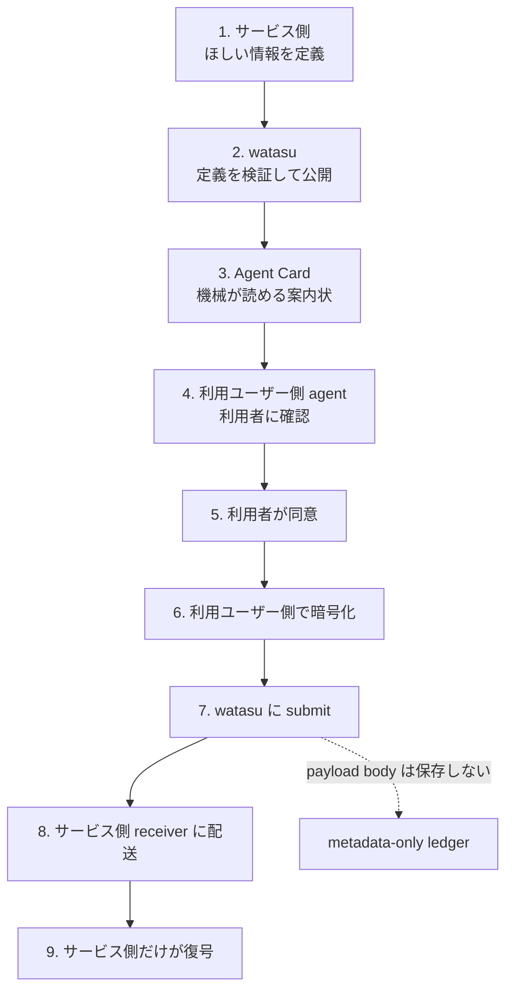
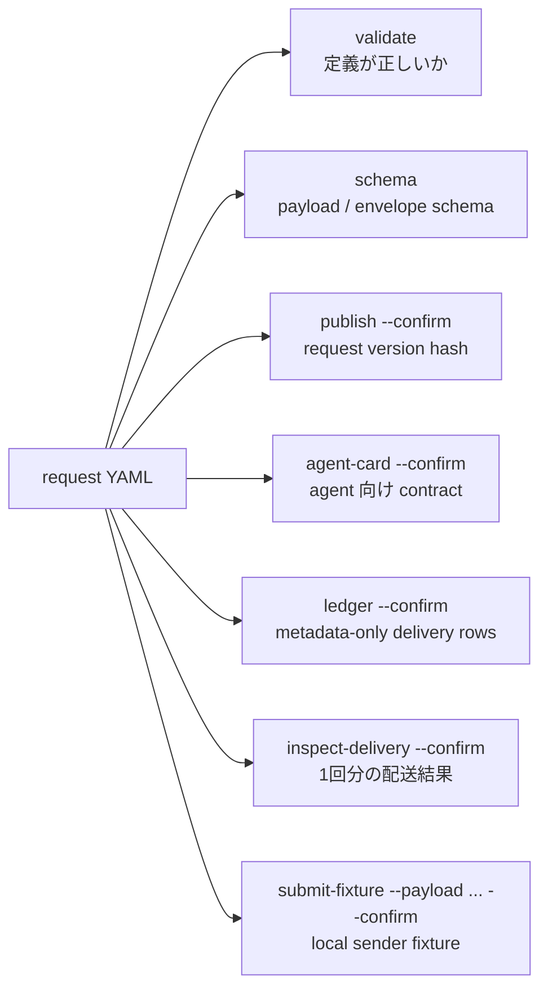
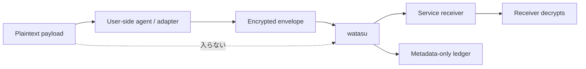

# watasu 利用者向けガイド

このガイドは、watasu を初めて触る人向けです。A2A、MCP、Agent Card を知らなくても、手元で「何が動いているか」を確認できるところまで案内します。

## まず結論

watasu は、個人データそのものを見るサービスではありません。サービス側が「このデータを、この目的で、この形式で送ってほしい」という contract を公開し、利用ユーザー側 agent がそれを読んで、利用者の同意後に payload を暗号化して送るための secure handoff rail です。

いま使えるのは、主に次の利用者です。

| あなた | できること |
| --- | --- |
| サービス開発者 | request definition を作り、schema / Agent Card / submit endpoint の形を確認する |
| サービス側 agent の実装者 | CLI / MCP / HTTP route を使って publish と ledger read の導線を組み込む |
| user-side agent / adapter の実装者 | Agent Card と schema を読み、payload を暗号化して submit する流れを実装する |
| private-alpha 運用者 | `https://api.watasu.ai` の health、MCP auth、cutover evidence を確認する |

まだ一般利用者向けの dashboard UI や human form builder はありません。

## 全体像



言い換えると、watasu は「中身を見ない配送レーン」です。

## 用語ミニ辞典

| 用語 | このガイドでの意味 |
| --- | --- |
| request definition | 何の情報を、なぜ、どこへ送るかを書いた YAML document |
| schema | payload の形を machine-readable にした JSON Schema |
| Agent Card | agent が読む案内状。endpoint、schema hash、暗号化情報、trust profile を含む |
| payload | 利用者が送る実データ。例: 名前や email |
| encrypted envelope | 暗号化済み payload と検証用 metadata を入れた submit body |
| ledger | 配送結果の記録。watasu では payload body を入れない metadata-only |
| no payload custody | watasu が plaintext payload を受け取らず、復号せず、保存しない境界 |

## 5分で見る

### 1. local handoff demo を動かす

repo root で実行します。

```bash
pnpm install
pnpm demo:handoff
```

成功すると、次のような JSON が出ます。

```json
{
  "ok": true,
  "sender": {
    "payload_values_sent_to_watasu": false
  },
  "watasu": {
    "submit_status": 202,
    "delivery_status": "delivered",
    "ledger_rows": 1,
    "ledger_contains_payload_body": false,
    "response_contains_plaintext_payload": false
  },
  "receiver": {
    "accepted": true
  }
}
```

見るポイントはこの3つです。

- `ok: true`: handoff が最後まで動いた
- `payload_values_sent_to_watasu: false`: sender fixture は plaintext payload を watasu に渡していない
- `ledger_contains_payload_body: false`: ledger に payload body が残っていない

### 2. request definition を見る

サンプルはここにあります。

```bash
packages/fixtures/requests/event-attendee.yaml
```

内容は「イベント参加者の名前と email を受け取りたい」という小さな request です。

```yaml
name: event-attendee-intake
fields:
  - id: full_name
    type: string
    required: true
  - id: email
    type: string
    format: email
    required: true
trust_profile: human_consent
```

### 3. CLI で検証する

```bash
pnpm --filter @watasu/cli watasu validate packages/fixtures/requests/event-attendee.yaml
```

期待する要点:

```json
{
  "ok": true,
  "command": "validate",
  "request": {
    "name": "event-attendee-intake",
    "field_count": 2
  }
}
```

## CLI で何が見られるか



よく使う順番:

```bash
pnpm --filter @watasu/cli watasu validate packages/fixtures/requests/event-attendee.yaml
pnpm --filter @watasu/cli watasu schema packages/fixtures/requests/event-attendee.yaml
pnpm --filter @watasu/cli watasu agent-card packages/fixtures/requests/event-attendee.yaml --confirm
```

配送結果まで見たいとき:

```bash
pnpm --filter @watasu/cli watasu inspect-delivery packages/fixtures/requests/event-attendee.yaml --confirm
```

local payload fixture を使うとき:

```bash
printf '{"full_name":"Alice Example","email":"alice@example.test"}' > /tmp/watasu-payload.json
pnpm --filter @watasu/cli watasu submit-fixture packages/fixtures/requests/event-attendee.yaml --payload /tmp/watasu-payload.json --confirm
```

注意: `submit-fixture` は local learning fixture です。production の実データ送信ではありません。

## Local HTTP demo を見る

HTTP route を実際に叩きたいときは local demo server を使います。

```bash
pnpm typecheck
pnpm --filter @watasu/http demo
```

別 terminal で確認します。

```bash
curl http://127.0.0.1:8787/.well-known/agent-card.json
curl http://127.0.0.1:8787/schemas/plaintext.json
curl http://127.0.0.1:8787/schemas/envelope.json
curl http://127.0.0.1:8787/ledger
```

local demo の route:

| Route | 役割 |
| --- | --- |
| `/.well-known/agent-card.json` | user-side agent が読む contract |
| `/schemas/plaintext.json` | 暗号化前 payload の schema |
| `/schemas/envelope.json` | submit する encrypted envelope の schema |
| `POST /submit` | A2A HTTP+JSON submission |
| `/ledger` | metadata-only delivery ledger |

## Production private alpha を見る

本番 origin は次です。

```text
https://api.watasu.ai
```

health check:

```bash
curl https://api.watasu.ai/health
```

期待する response:

```json
{"ok":true,"service":"watasu-hosted"}
```

MCP protected-resource metadata:

```bash
curl https://api.watasu.ai/.well-known/oauth-protected-resource
```

期待する要点:

```json
{
  "resource": "https://api.watasu.ai/mcp",
  "scopes_supported": ["watasu:publish", "watasu:ledger:read"],
  "bearer_methods_supported": ["header"]
}
```

MCP endpoint:

```bash
curl https://api.watasu.ai/mcp
```

Bearer token なしでは `401` が正しいです。これは、hosted MCP が誰でも使える状態ではないという確認です。

## production と local demo の違い

| 項目 | local demo | production private alpha |
| --- | --- | --- |
| 目的 | 学習、手元確認、no payload custody の確認 | private-alpha の hosted runtime |
| endpoint | `127.0.0.1:8787` | `https://api.watasu.ai` |
| publish | fixture / local in-memory | authenticated MCP / service identity 境界 |
| MCP | local MCP server package | hosted `/mcp` with Bearer auth |
| ledger | metadata-only local rows | metadata-only hosted boundary |
| UI | なし | なし |

## watasu が守ること



watasu の security promise:

- plaintext payload を受け取らない
- payload を復号しない
- plaintext payload を保存しない
- encrypted payload body を delivery attempt 後に保持しない
- payload retry queue を持たない
- ledger は metadata-only に限定する
- Agent Card に secret、private key、receiver private URL を入れない

## よくある質問

### これはフォーム作成ツール？

違います。watasu は human form builder ではありません。agent が読む contract と encrypted intake endpoint を作るための rail です。

### 誰でも `api.watasu.ai` にデータを送れる？

いいえ。production の hosted MCP は Bearer auth が必要です。published request ごとの submit route も、request definition、schema hash、trust profile、sender auth、idempotency などの検証を通す前提です。

### watasu は利用者の個人データを保存する？

plaintext payload は保存しません。配送証跡も payload body ではなく metadata-only です。ただし metadata も組み合わせで個人関連情報になり得るので、tenant、role、audit、retention の境界を置きます。

### user-side agent は watasu に含まれる？

含まれません。user-side agent、personal vault、consumer AI companion は MVP スコープ外です。別プロダクトまたは adapter が、Agent Card を読み、利用者に確認し、payload を暗号化して submit します。

### README とこのガイドの違いは？

README は repo の入口です。このガイドは、予備知識なしで手を動かすための tutorial / how-to です。詳細な仕様は [PRD](prd-cli-mvp.md)、[ERD](erd-cli-mvp.md)、[MVP plan](mvp-plan.md) にあります。

## Troubleshooting

### `pnpm install` が失敗する

Node.js 22 以上と pnpm 10.31.0 を使ってください。

```bash
node --version
pnpm --version
```

### `publish` や `agent-card` が confirmation error になる

publish 系の command は明示的な確認が必要です。`--confirm` を付けてください。

```bash
pnpm --filter @watasu/cli watasu agent-card packages/fixtures/requests/event-attendee.yaml --confirm
```

### local HTTP demo の port が使われている

`127.0.0.1:8787` を使います。別 process が使っている場合は停止してから再実行してください。

### `/mcp` が 401 になる

production では正しい挙動です。hosted MCP は Bearer token なしで使えません。

### demo が通ったのに安全と言い切ってよい？

いいえ。demo は重要な証跡ですが、安全性の証明そのものではありません。security boundary に触れる変更では `pnpm loop`、secret scan、依存監査、manual checks、gstack review を組み合わせます。

## 次に読むもの

- [README.ja.md](../README.ja.md): repo の入口
- [docs/mvp-plan.md](mvp-plan.md): current status と production cutover evidence
- [docs/prd-cli-mvp.md](prd-cli-mvp.md): product requirements
- [docs/erd-cli-mvp.md](erd-cli-mvp.md): engineering requirements
- [docs/protocol-baseline.md](protocol-baseline.md): protocol / dependency baseline
